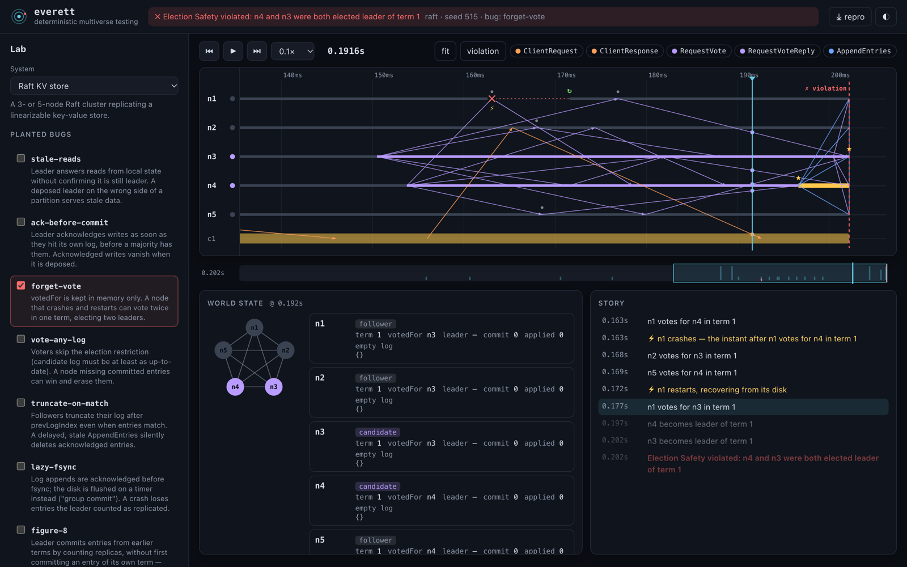
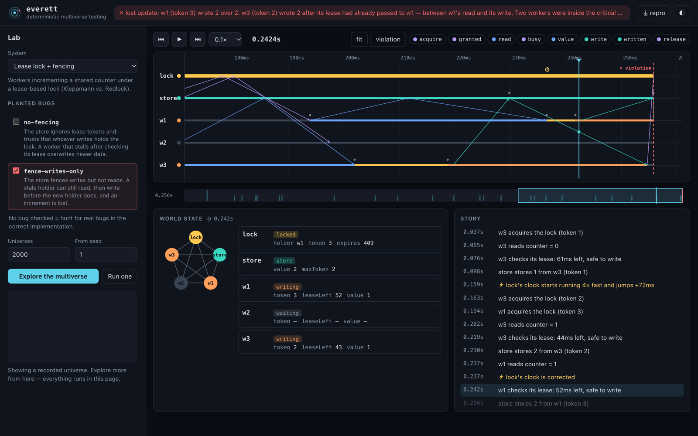

<div align="center">

# Everett

**Run your distributed system in ten thousand parallel universes.<br>
Find the one where it breaks. Shrink it to a story you can read in ten seconds.<br>
Replay it, bit for bit, forever.**

Deterministic simulation testing for distributed systems, with a time-travel debugger that runs in your browser.<br>
Zero dependencies. Plain JavaScript. Node or browser.



</div>

---

```console
$ everett explore raft --bug forget-vote

  everett · Raft KV store · bugs: forget-vote
  exploring 2,000 universes from seed 1 on 9 workers

  ✗ universe #515 broke after 635 universes (1.2s)
  ✗ invariant:election-safety  at 0.202s
    Election Safety violated: n4 and n3 were both elected leader of term 1

  shrunk in 146 replays (19ms)
    faults 11 → 1 · ops 4 → 1 · clients 4 → 1 · time 8.000s → 0.263s

  minimal reproduction (seed 515)
     0.163s    n1 votes for n4 in term 1
     0.163s  ⚡ n1 crashes — the instant after n1 votes for n4 in term 1
     0.168s    n2 votes for n3 in term 1
     0.169s    n5 votes for n4 in term 1
     0.172s  ⚡ n1 restarts, recovering from its disk
     0.177s    n1 votes for n3 in term 1
     0.197s    n4 becomes leader of term 1
     0.202s    n3 becomes leader of term 1

  ✓ replay is bit-for-bit deterministic (fingerprint 66478eebe152ebdb)
  → repro saved       .everett/raft-forget-vote-515.json
  → time-travel view  .everett/raft-forget-vote-515.html
```

That's a real Raft implementation with one real-world mistake: `votedFor` lives only in memory. Nobody told Everett where to look. It searched 515 universes of partitions, crashes, stalls and clock drift; found one where two leaders were elected in the same term; cut away everything irrelevant; and handed back four lines that explain the bug. A node voted, crashed in the same instant, came back without remembering its vote, and voted again.

## Why

Distributed systems fail in the gaps between events: a crash *between* a vote and its fsync, a GC pause *between* checking a lease and using it, a packet that arrives *after* the partition healed. These interleavings are astronomically rare in tests and inevitable in production. When they do show up, they almost never reproduce.

The teams that ship the most reliable distributed databases ([FoundationDB](https://apple.github.io/foundationdb/testing.html), [TigerBeetle](https://github.com/tigerbeetle/tigerbeetle/blob/main/docs/internals/vopr.md)) don't rely on luck. They run their entire cluster inside a **deterministic simulator**: one process, one thread, one random seed controlling every message delay, every crash and every clock tick. Then they run millions of seeds. Every bug comes with a seed, and every seed replays exactly.

That approach has mostly lived inside the codebases that invented it. Everett makes it a tool:

- **A deterministic world.** Network (latency tails, loss, duplication, reordering, symmetric, asymmetric *and non-transitive* partitions), disks with honest `fsync` semantics, crashes, stop-the-world pauses, and clocks that drift and jump.
- **An adversarial nemesis.** Swarm-tested fault schedules, plus **event-triggered faults** that strike at the worst possible moment: *"crash n1 the instant after it votes"*, *"isolate the leader the moment it's elected"*.
- **Oracles that know what wrong means.** A [linearizability](https://cs.brown.edu/~mph/HerlihyW90/p463-herlihy.pdf) checker (Wing & Gong with Lowe's memoization, the algorithm behind Knossos and Porcupine) that *explains* violations in plain English, plus live invariant monitors and post-heal liveness checks.
- **A shrinker that tells a story.** Delta debugging over fault groups, nodes, clients and network weather, plus *resampling* to escape the butterfly effect. 46 faults and 200 operations become one fault and a handful of operations.
- **Bit-for-bit replay.** Every universe has a 96-bit fingerprint. A repro file replays identically on any machine, and the test suite checks it.
- **A time-travel debugger.** A single self-contained HTML file showing a space-time diagram of every message, crash, pause and partition. Scrub through time, watch messages in flight, inspect each node's log and state at any instant. It also runs the whole multiverse search **in the browser**.

## Quick start

Requires Node 18+. No `npm install`; there are no dependencies.

```bash
git clone https://github.com/vipul080/everett && cd everett

node bin/everett.js explore raft --bug forget-vote     # find, shrink, explain
node bin/everett.js explore raft --seeds 20000         # hunt the correct implementation
node bin/everett.js explore gossip-register            # a design that's wrong as written
node bin/everett.js list                               # systems and their planted bugs
npm link                                               # optional: put `everett` on your PATH
```

Then open the generated `.everett/*.html` file, or the lab:

```bash
open dist/everett-lab.html
```

The lab is the whole engine in one 160 KB file. Pick a bug, press **Explore**, and watch the universe grid fill in until one turns red. It shrinks the failure and drops you into the debugger at the moment things go wrong. Click any square to open that universe.

## The bug zoo

Everett ships with a by-the-paper [Raft](https://raft.github.io/raft.pdf) key-value store (elections, log replication, fsync-before-ack, client sessions, linearizable reads) and a set of switchable bugs. **Every one of them is a mistake that has shipped in a real system.** Correct Raft passes 40,000 consecutive universes (seeds 1–40,000). Each bug is found automatically:

| system | bug | first broken universe (1 core) | faults: found → shrunk | caught by |
|---|---|---|---|---|
| raft | `stale-reads` | #47 (0.2s) | 46 → **1** | `linearizability` |
| raft | `ack-before-commit` | #5 (0.0s) | 38 → **4** | `linearizability` |
| raft | `forget-vote` | #515 (2.9s) | 11 → **1** | `invariant:election-safety` |
| raft | `vote-any-log` | #10 (0.0s) | 70 → **4** | `invariant:leader-completeness` |
| raft | `truncate-on-match` | #1 (0.0s) | 28 → **0** | `invariant:leader-completeness` |
| raft | `lazy-fsync` | #17 (0.1s) | 14 → **4** | `liveness` |
| raft | `figure-8` | #1363 (7.7s) | 79 → **5** | `invariant:leader-completeness` |
| lease-lock | `no-fencing` | #1 (0.0s) | 44 → **2** | `invariant:lost-update` |
| lease-lock | `fence-writes-only` | #1 (0.0s) | 44 → **2** | `invariant:lost-update` |

<sub>Regenerate with `node scripts/zoo.js`.</sub>

Some highlights:

- **`figure-8`** is the scenario from Figure 8 of the Raft paper: a leader counts replicas for an entry from an earlier term, calls it committed, and a later leader overwrites it. Everett finds that sequence of elections and stalls with no hints.
- **`stale-reads`** shrinks to a single fault, and the shrunk version is subtler than the textbook one. The old leader goes mute, and the *new* leader answers a read before it has committed anything in its own term. Its state machine is still behind, so the read is stale. This is exactly why the Raft paper requires a fresh-term commit before serving reads.
- **`truncate-on-match`** needs no faults at all. Ordinary network reordering is enough for a stale `AppendEntries` to delete acknowledged entries.

### The distributed-lock debate, made executable

[`examples/lease-lock`](examples/lease-lock/index.js) puts [Martin Kleppmann's argument about Redlock](https://martin.kleppmann.com/2016/02/08/how-to-do-distributed-locking.html) on trial. Workers increment a shared counter under a lease-based lock and dutifully check their lease before writing. Everett breaks it in the first universe: the lock server's clock jumps ahead, a second lease is granted while the first holder is mid-write, and an increment is lost. Fencing tokens fix it, but only if the storage checks them on **reads as well as writes**. Fence only the writes and Everett still finds the hole.



## Test your own system

A system is a plain object. Nodes are event handlers. Everything nondeterministic goes through `ctx`. Here is the complete [`examples/gossip-register`](examples/gossip-register/index.js), a replicated register that accepts writes anywhere and gossips them:

```js
import { kvModel, kvGenerator } from 'everett';

class Replica {
  constructor(ctx) { this.ctx = ctx; this.data = new Map(); }

  onMessage(from, m) {
    if (m.type === 'put') {
      this.data.set(m.key, m.value);
      for (const peer of this.ctx.peers) this.ctx.send(peer, { type: 'sync', key: m.key, value: m.value });
      this.ctx.send(from, { type: 'reply', id: m.id, value: true });
    } else if (m.type === 'get') {
      this.ctx.send(from, { type: 'reply', id: m.id, value: this.data.get(m.key) ?? null });
    } else if (m.type === 'sync') {
      this.data.set(m.key, m.value);
    }
  }

  inspect() { return { role: 'replica', kv: Object.fromEntries(this.data) }; }  // for the debugger
}

class Client {
  constructor(ctx) { this.ctx = ctx; this.seq = 0; }
  invoke(op, done) {               // report exactly once: { type: 'ok', value } or { type: 'info' }
    const id = ++this.seq;
    const node = this.ctx.nodes[this.ctx.randomInt(0, this.ctx.nodes.length - 1)];
    this.ctx.send(node, { type: op.f, key: op.key, value: op.value, id });
    const timer = this.ctx.setTimer(500, () => { this.pending = null; done({ type: 'info' }); });
    this.pending = { id, done, timer };
  }
  onMessage(from, m) {
    if (m.id !== this.pending?.id) return;
    this.ctx.cancelTimer(this.pending.timer);
    const { done } = this.pending; this.pending = null;
    done({ type: 'ok', value: m.value });
  }
}

export const system = {
  name: 'gossip-register',
  defaults: { nodes: 3, clients: 3 },
  createNode: (ctx) => new Replica(ctx),
  createClient: (ctx) => new Client(ctx),
  workload: () => kvGenerator({ keys: ['x'], cas: 0 }),
  model: kvModel,
};
```

```console
$ everett explore ./my-system.js
  ✗ universe #1 broke after 9 universes
  minimal reproduction
     0.065s    c1 put x=1
     0.068s  ✗ c2 get x → nil   ← impossible
  c2 get x → nil — but c1 had already written 1 (acknowledged at 0.065s). An acknowledged write vanished.
```

### The `ctx` API

| | |
|---|---|
| `ctx.id`, `ctx.peers`, `ctx.nodes`, `ctx.clients` | identity and membership |
| `ctx.send(to, msg)` | send a message (deep-copied; subject to latency, loss, duplication, partitions) |
| `ctx.setTimer(ms, fn)` → id, `ctx.cancelTimer(id)` | timers run on the node's own, possibly skewed, clock |
| `ctx.now()` | the node's local clock in ms (drifts and jumps under clock faults) |
| `ctx.random()`, `ctx.randomInt(lo, hi)` | the node's deterministic random stream |
| `ctx.disk.get/set/delete/has(key)`, `ctx.disk.fsync()` | durable storage; unsynced writes are lost on crash, all or a random subset |
| `ctx.emit(kind, data)` | tell monitors (and the debugger) something happened |
| `ctx.log(...)` | annotate the trace |

Node classes implement `onStart()` (called on boot *and* on every restart: recover from `ctx.disk`), `onMessage(from, msg)`, and optionally `inspect()`. Code that reaches for `Math.random()` or `Date.now()` by accident is caught by the determinism guard and routed to the universe's own sources, so replay still holds.

### The system object

| field | |
|---|---|
| `createNode(ctx, { bugs, params })` | build a node (called again after every crash) |
| `createClient(ctx, opts)`, `workload(cfg)`, `model` | optional client workload, checked for linearizability against `model` |
| `monitors(opts)` → `[{ name, onEmit(e) → violation?, onEnd(world) }]` | invariants with a god's-eye view |
| `faults`, `targets`, `triggers` | which chaos applies, to which nodes, and which emitted events the nemesis may strike after |
| `defaults` | nodes, clients, duration, liveness window, network overrides |
| `describe(event)`, `messageColors` | narration and colours for the story and the debugger |
| `bugs` | named, switchable mistakes; great for demonstrating that your tests can actually catch things |

## How it works

```
 seed ──► scenario (plain JSON)              the universe, fully explicit:
           │  topology, network weather,       swarm-chosen fault types and intensities,
           │  disk loss mode, workload,        timed faults + event-triggered faults
           │  fault schedule, triggers
           ▼
        World ─ one thread, one event heap ordered by (time, seq)
           │    network: counter-based randomness per (link, message #)
           │    disk: page cache vs. durable; crash drops unsynced writes
           │    clocks: per-node rate and offset; timers run on local time
           ▼
        verdict ◄─ monitors (live) · liveness after heal · linearizability (WGL)
           │
           ├─ ok ──► next universe            worker threads explore seed ranges in parallel
           └─ ✗ ──► shrink ──► replay with recording ──► narrate · repro.json · debugger.html
```

A few design choices are worth calling out:

- **Counter-based randomness for the network.** The fate of a message is `hash(seed, link, n)`, where `n` is the message's index on that link. It doesn't come from a shared stream. Removing an unrelated fault therefore leaves most messages' fates unchanged, which keeps the shrinker close to the original universe.
- **Resampling shrinker.** Removing an early fault can still change everything downstream. When structural shrinking stalls, Everett draws fresh universes from a *smaller version of the same recipe* (only the fault types still present, fewer of them, a shorter run) and shrinks whichever ones fail the same way.
- **Honest client semantics.** A request that times out is recorded as *unknown*, not *failed*, because it might still commit. The checker lets unknown operations take effect at any later point, or never. That rules out false alarms without hiding real ones.
- **Recording doesn't perturb.** The recorder never draws randomness or schedules events. The tests verify that recorded and unrecorded runs, and the browser bundle, produce identical fingerprints.

### Performance

On an Apple-silicon laptop: a full 8-second Raft universe (5 nodes, ~6,000 events, ~300 client operations, linearizability-checked) runs in about **5 ms on one core**, roughly 1.8M simulated events per second. With worker threads the CLI sustains **7M+ events/s**, around 20,000 Raft universes in under 30 seconds. The lease-lock system runs about **10,000 universes per second**.

## Honest limitations

- Everett tests code written against `ctx`: an event-driven, single-threaded node model. It does not intercept arbitrary Node.js I/O, and it can't take an unmodified production service as-is. (This is the same trade-off FoundationDB and TigerBeetle make; their simulators drive their own abstractions too.)
- It finds what its oracles can see. Linearizability covers the key-value model out of the box; anything else needs a model or a monitor.
- Within a single handler, a crash takes effect afterwards, never midway. Bugs that need a crash *between two statements* must be modelled as two steps (the lease-lock example does exactly this).
- Searching is random plus swarm plus triggers, not exhaustive. A clean run of 20,000 universes is strong evidence, not a proof.

## Prior art and credits

Everett stands on a lot of excellent work: FoundationDB's [simulation testing](https://www.youtube.com/watch?v=4fFDFbi3toc), TigerBeetle's [VOPR](https://github.com/tigerbeetle/tigerbeetle/blob/main/docs/internals/vopr.md), [Jepsen](https://jepsen.io) and [Knossos](https://github.com/jepsen-io/knossos), [Porcupine](https://github.com/anishathalye/porcupine), [Antithesis](https://antithesis.com), Rust's [madsim](https://github.com/madsim-rs/madsim) and [turmoil](https://github.com/tokio-rs/turmoil), [swarm testing](https://users.cs.utah.edu/~regehr/papers/swarm12.pdf) (Groce et al.), [delta debugging](https://doi.org/10.1109/32.988498) (Zeller & Hildebrandt), and of course [Raft](https://raft.github.io/raft.pdf) (Ongaro & Ousterhout). The name comes from Hugh Everett III, whose many-worlds interpretation says every possible outcome happens in some universe. Everett's job is to find yours.

## Layout

```
src/            the engine: world, network, disk, scenario, run, shrink, explore, narrate
src/checker/    linearizability (WGL + memoization) and sequential models
src/node/       Node-only: worker-thread explorer, system loader, single-file bundler
examples/       raft (+ bug zoo), lease-lock (Kleppmann vs. Redlock), gossip-register
viz/            the time-travel debugger and in-browser lab
bin/everett.js  the CLI
test/           node --test: core, checker, systems, determinism, shrinking, CLI
```

```bash
npm test             # 39 tests, ~3 seconds
npm run build        # rebuild dist/everett-lab.html
```

## License

MIT
